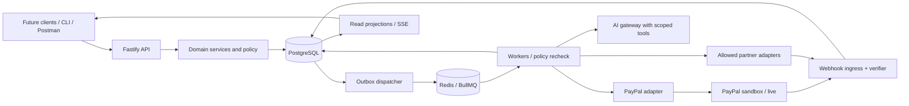

# Backend architecture and technology decisions

All choices here are proposed implementation decisions. Pin exact dependency versions in Phase 0 after compatibility and license checks. Choose a modular monolith with separate API and worker processes. This keeps payment invariants in one PostgreSQL transaction boundary while allowing independently scaled I/O and AI jobs.

## Stack by responsibility

| Responsibility | Choice | Rationale and boundary |
|---|---|---|
| Runtime | Node.js 24 LTS, TypeScript strict mode | Conservative maintained runtime; compile before deployment, verify host support |
| HTTP | Fastify 5 + TypeBox JSON Schema + Ajv | Runtime input/output schemas; reject unknown sensitive fields; async policy checks after structural validation |
| API contract | OpenAPI 3.1, generated from registered schemas with compatibility validation | One contract source; 06 defines shapes and operation inventory |
| Relational persistence | PostgreSQL 18, `pg` + Kysely, reviewed SQL migrations | Typed queries with explicit SQL locks/constraints; managed host version may require a tested 17 fallback ADR |
| Jobs | Redis-compatible managed service + BullMQ | Delivery and scheduling only; PostgreSQL owns job/business state |
| Identity | `@simplewebauthn/server`, opaque server sessions, optional PayPal login | Passkeys and session rotation; identity permissions separate from payment capabilities |
| Payment provider | PayPal REST server adapter, selective official SDK/AI Toolkit | Exact provider mappings isolated; raw amount strings converted at boundary |
| AI calls | Small provider-neutral interface; one schema-capable cloud model initially | No need to reproduce coding harness topology inside product; pin model/version/prompt in traces |
| Agent planning | Explicit mission state machine + BullMQ for MVP | Durable state in PG; consider LangGraph only for branching reasoning, Temporal later for complex long-lived sagas |
| Own-store search | PostgreSQL text search initially | Product authority remains merchant catalog; Elastic enhancement separately indexed and reconstructable |
| External discovery | Channel3 adapter where entitled; approved eBay adapter | Network allowlists, timeout and provenance; discovery access does not grant checkout rights |
| User browser automation | Existing Playwright MCP extension + local TypeScript policy gateway; optional Hermes/Browser Use reasoning harness | Selected signed-in user tab, task-scoped grants and proposal approval; actual site permissions and detailed contract in16 |
| Receipts | Secure object upload + local OCR worker or consented cloud vision | Isolated untrusted files; extracted data always reviewed before obligations |
| Object storage | S3-compatible private buckets; MinIO locally | Short-lived signed upload/download grants, scan lifecycle, retention |
| Real-time state | Authenticated SSE with polling fallback | Read projections only; reconnect cursor, tenant filters, no command execution |
| Telemetry | OpenTelemetry + structured Pino logs + metric exporter | Redaction at source; no financial truth in logs/indexes |
| Testing | Vitest, fast-check, Testcontainers, Postman/Newman, k6 | See 10 for layers and what must actually run |
| Deployment | Render API/worker/managed data where supported, Docker local | Sponsor integration with reproducible local alternative and paid availability check |
| Developer artifacts | pnpm workspace, Docker Compose, CI | Reproducible contract, migration and fixture tooling |

Fastify supports schema validation/response serialization; use code-owned schemas and put database authorization in hooks/services after structural checks. [Official validation docs](https://fastify.dev/docs/latest/Reference/Validation-and-Serialization/). Confirm the runtime's supported lifecycle before pinning. [Node release schedule](https://nodejs.org/en/about/previous-releases).

## Process and trust boundaries



API authenticates principals and accepts commands. Domain services enforce permissions and invariants. Workers re-evaluate expiry, capability and revocation before side effects. AI sees typed tools and redacted business facts, not repository shell access or provider secrets. Egress gateway validates host, path, redirect and request size. No client or AI input selects an arbitrary provider base URL.

## Module ownership

| Module | Owns | May request from others |
|---|---|---|
| identity | Users, contacts, sessions, verification, consent | Step-up requirements from authorization |
| capabilities | Country/product/provider entitlements, feature flags | Provider health and account facts |
| commerce | Catalog, inventory holds, quotes, fulfilment | Payment-intent creation, never direct capture |
| missions | Shopping goals, budget policies, agent traces | Catalog/negotiation tools and payment proposal |
| authorization | Challenge, immutable action digest, one-use grant | Identity verifier and fresh canonical intent |
| payments | Intents, provider operations, captures, refunds | Journal posting, capability decision, grants |
| fx | Currency metadata, quotes, fees, reporting valuation | Approved provider FX facts, never a virtual balance |
| social | Requests, groups, splits, allocation revisions | Eligible intent routing after explicit acceptance |
| earnings | Jobs, partner approval, payout obligations | Payments payout adapter through service boundary |
| business | Invoices, subscriptions, entitlements, campaign metadata | Provider billing adapters and settled projections |
| journal | Immutable observations, balanced entries, reversals | Separately typed verified provider settlement facts or verified business obligation evidence; never treat an accrual as available funds |
| integrations | Adapter registry, secrets reference, webhook bindings | Narrow domain commands through inbox processor |
| notifications | Consented messages and status delivery | Outbox event; failure never rolls back settlement |

Enforce ownership in imports: route -> application command -> domain -> repository/port. Adapters implement ports. Modules do not update each other's tables by ad-hoc SQL. Cross-module commands that require atomicity share a unit-of-work/transaction object with explicit ownership review.

## Proposed repository shape

```text
apps/api/src/{routes,hooks,bootstrap}
apps/worker/src/{processors,schedulers,bootstrap}
packages/contracts/src/{schemas,events,problems}
packages/domain/src/{identity,commerce,missions,payments,fx,social,earnings,journal}
packages/adapters/src/{paypal,channel3,ebay,partner-demo,ai,storage}
packages/db/{migrations,queries,seeds}
packages/testing/{builders,fake-provider,fixtures,contracts}
tools/{capability-probe,reconcile,seed-demo,validate-plan}
tests/{unit,properties,integration,contract,sandbox,security,load,evaluations}
infra/{compose,render,ci}
Plan/
```

These paths are to create during development; they do not exist yet. A package for every entity is unnecessary. Keep shared Money/capability/error types small; do not create one giant utility layer with payment privileges.

## Request lifecycle

1. Assign trusted request ID; apply endpoint/body/rate limits and content-type policy.
2. Parse and schema-validate body/query/params. Amount strings reject signs, exponent forms and leading zeros except zero.
3. Resolve session/partner principal, tenant and CSRF/origin checks appropriate to authentication method.
4. Load exact object by principal-scoped query; apply actor permission and current capability rules.
5. Resolve idempotency key and canonical request hash; apply optimistic object revision check if needed.
6. In a short PG transaction, lock relevant rows in stable order; write business state, operation and outbox event together.
7. Return created object or 202 operation resource; perform no indefinite polling inside the request.
8. Worker executes a stable provider operation, persists result and emits projection event transactionally.

## Durable jobs and sagas

Redis loss may delay work but must not lose an accepted obligation. Dispatcher scans undispatched outbox rows in batches using short leases and `FOR UPDATE SKIP LOCKED`; commits the lease, enqueues a deterministic job ID, then records acknowledgement. A crash in either direction yields duplicate delivery, resolved by the business operation uniqueness constraint.

Every processor starts by loading its operation from PG. If already terminal it returns existing outcome. If another active lease owns it, it defers. Lease expiry authorizes recovery inspection, not blind provider resubmission. Unknown side effects enter reconciliation. Retryable read operations use bounded exponential delay/jitter and provider `Retry-After`; money mutations retry only within documented same-operation idempotency guarantees.

Illustrative interface:

```ts
type OperationResult =
  | { kind: 'confirmed'; providerId: string; facts: VerifiedFacts }
  | { kind: 'rejected'; code: string; retryable: false }
  | { kind: 'unknown'; lookup: ReconciliationLocator };

interface PaymentPort {
  createOrder(op: FrozenOperation): Promise<OperationResult>;
  capture(op: FrozenOperation): Promise<OperationResult>;
  inspect(locator: ReconciliationLocator): Promise<VerifiedFacts>;
}
```

`FrozenOperation` includes environment, credential binding, payee, amount, operation key and request hash. It cannot be mutated after first submission. An intent and an operation are different: one intent can have order creation, capture and partial refund operations with different stable keys.

Queue jobs should remain simple and idempotent; queue retries alone do not protect external effects. [BullMQ idempotent jobs](https://docs.bullmq.io/patterns/idempotent-jobs). PG concurrency failures must be handled by retrying the whole safe transaction, not continuing a failed one. [Transaction isolation](https://www.postgresql.org/docs/current/transaction-iso.html).

## State authority and caching

- PG is authoritative for policy, intent, authorization, obligations and observations.
- PayPal is authoritative for provider execution status. Reconcile discrepancies instead of overwriting evidence.
- Redis caches discovery responses, rate limits and job transport; never store the only remaining budget or approval there.
- Elastic contains redacted read/search projections; rebuild from PG/outbox. Index freshness is explicit.
- S3 stores immutable receipt objects referenced by content hash and scan status; it is not the authorization database.
- Model memory can remember preferences only with consent. It never supplies current provider status or spending authority.

## Performance and resource budget

Initial design targets, to measure: p95 reads under 300 ms, commands under 500 ms excluding provider/AI waits, webhook durable accept under 2 s with bounded verification path, own-store quote computation under 200 ms. Cap body size at 256 KiB for normal JSON and separately bounded raw webhook size; uploads go directly to private storage. Default page limit 25/max100; partner events <=128 KiB; receipt image <=10 MiB/20 megapixels after decode. These are tunable application limits, not provider guarantees.

Start with one API and one worker, constrained database pools (e.g. 10 and 5 connections), separate AI job concurrency 2 and payment job concurrency 4. Load tests determine final values. Use per-merchant fairness and token budgets so OCR/agents cannot starve payment reconciliation. Backpressure returns 429/503 with retry guidance before accepting unpersistable work.

## Architecture checklist

- [ ] Pin runtime, package manager and container digests.
- [ ] Prove TypeBox/Fastify/OpenAPI 3.1 compatibility in a tiny route; choose explicit adapter if generators need a schema conversion.
- [ ] Prove PG version and Redis/BullMQ command compatibility on selected host.
- [ ] Enforce module import boundaries and typed external ports.
- [ ] Implement transactional inbox/outbox and worker recovery before agents.
- [ ] Put reconciliation on a separate high-priority queue.
- [ ] Keep all provider credentials in adapters and secret references.
- [ ] Prevent simulator operations from using sandbox/live adapters by environment discriminator.
- [ ] Record ADRs for any stack changes with migration/test implications.
- [ ] Defer microservices until observed scaling or isolation needs justify them.
